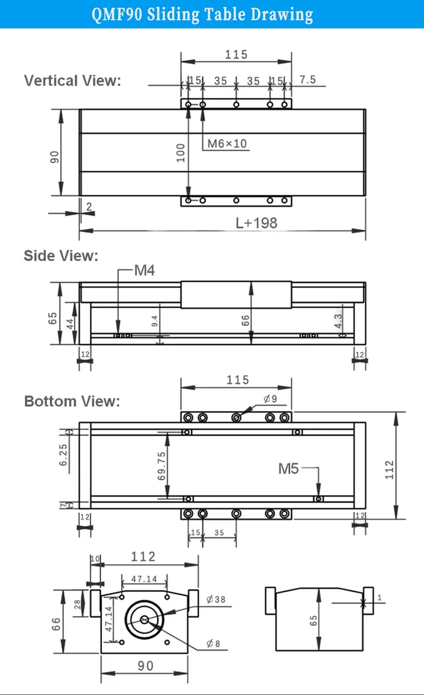
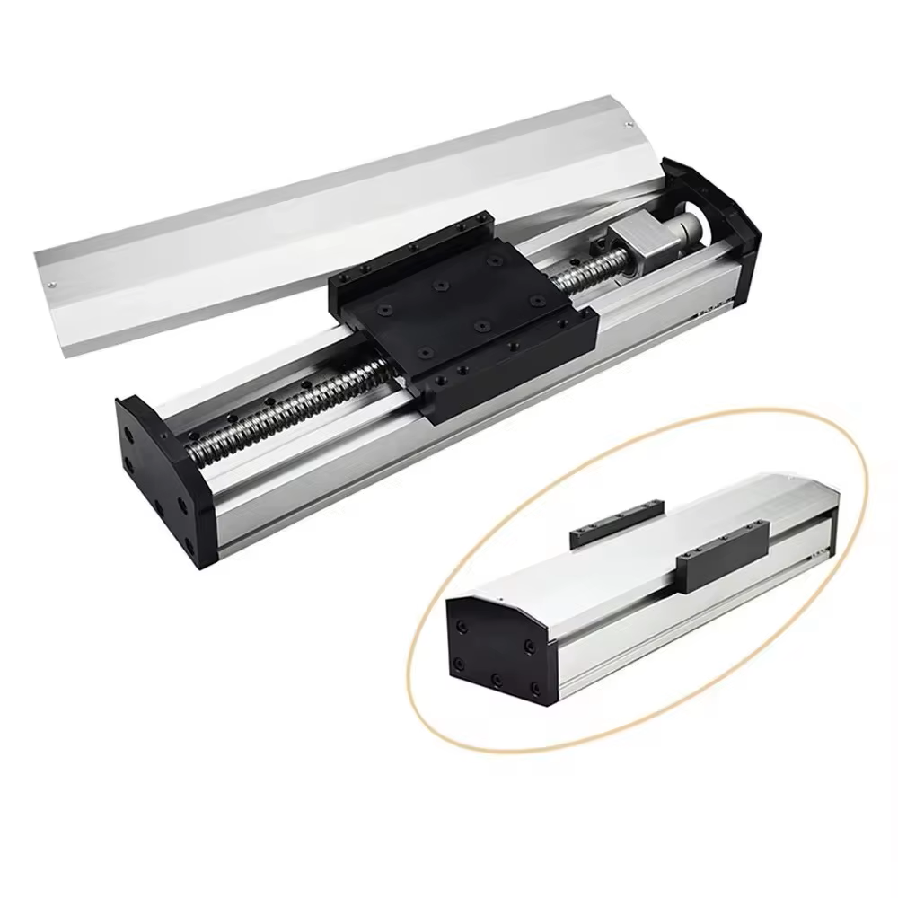
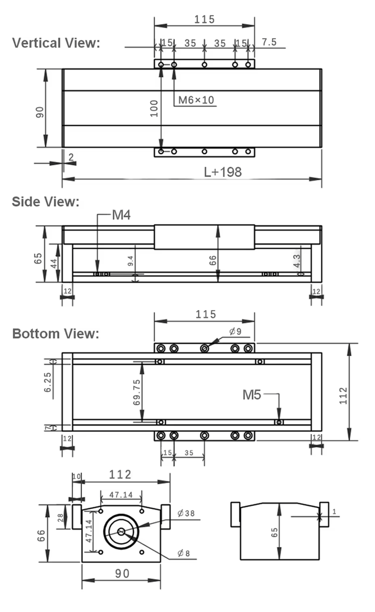
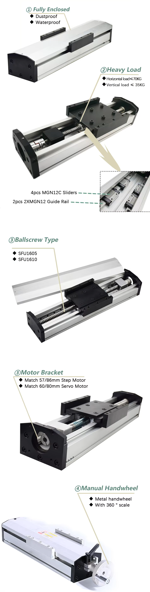

## Purchase Links

## X & Z Sliding Tables

[AliExpress Page](https://www.aliexpress.us/item/3256807357569305.html)
[Orders](https://www.aliexpress.com/p/order/index.html)

- Model: QMF90
- Ballscrew type: SFU1605
  - Screw Diameter 16mm
  - Pitch 5mm (linear travel of 5mm per rev)
- Ballscrew accuracy: C7 level
- Effective stroke: 100mm-300mm Optional
- Total length: Effective stroke + 170mm
- Module width: 90mm
- Guide diameter: 12mm
- Guide Type: 2x MGN12C
- Horizontal load: Max 70 kg
- Vertical load: Max 35 kg
- Maximum speed: 250mm/s
- Ballscrew Repeat positioning accuracy: 0.03-0.05mm
- Motor bracket motor support: Nema 23 stepper motor
- Base plate material: Aluminium alloy

### Drawings

## Y Sliding Tables

[AliExpress Page](https://www.aliexpress.us/item/3256806062901132.html?spm=a2g0o.order_list.order_list_main.5.21ef18028Q2ktl&gatewayAdapt=glo2usa)
[Orders](https://www.aliexpress.com/p/order/index.html)

- Model:QMF90
- Material: Industrial Aluminum Profile
- Stroke: 500mm
- Module width: 90mm
- Guide Rail Type: 2Pcs *MGN12
- Sliders type: 4Pcs * MGN12C
- Horizontal load: 70KG (Max)
- Vertical load: 35KG(Max)
- Motor bracket: Nema23/57mm stepper motor
- Ball Screw
  - Material: Bearing Steel
  - Ballscrew type: SFU1605
    - Diameter 16mm
    - Pitch 5mm (linear travel of 5mm per rev)
  - Repeat positioning accuracy: 0.03mm-0.05mm
  - Accuracy: C7
  - Max. moving speed: SFU1605:250mm/s

### Drawings

